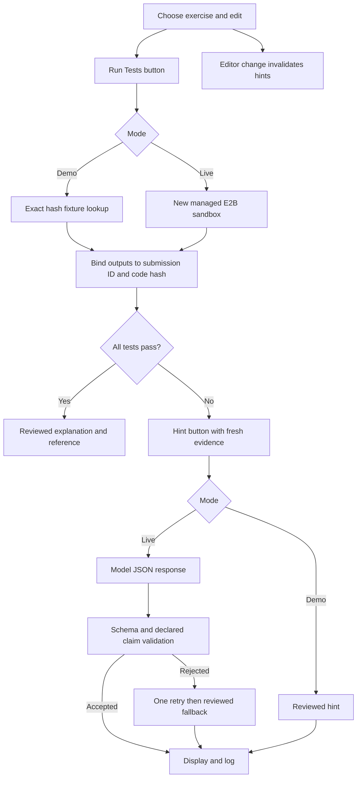

# TraceTutor

SDG 4 — Quality Education. A fifth-semester CSE prototype using an existing hosted
LLM to help beginners debug five authored Python exercises. No model is trained.
Similar tutors exist; neither novelty nor improved learning or retention is claimed.

## Setup

Clone `https://github.com/VARUN-GOWDAB/Trace_Tutor.git` and open the checkout.
Use Python 3.11 or 3.12. Inspect and reuse a suitable existing `.venv`.

```powershell
py -3.12 -m venv .venv
.\.venv\Scripts\python.exe -m pip install -r requirements.txt
Copy-Item .env.example .env
.\.venv\Scripts\python.exe -m streamlit run app.py
.\.venv\Scripts\python.exe -m pytest -q
```

On macOS/Linux, use `python3 -m venv .venv`, `cp .env.example .env`, then
`./.venv/bin/python` for pip, pytest and Streamlit commands. `.env` holds local
configuration; `.venv` holds the Python environment. Both are ignored. Each teammate
creates their own environment; never copy or upload it. See VERIFICATION.md for
commands and outcomes from this implementation.

## Workflow and configuration

Choose an exercise, edit the starter and click Run Tests. Inspect the table, request
up to three hints, then rerun tests after editing. Any edit makes results stale and
clears hint history, even if subsequently undone. Exercise/mode changes reset state.
Reset restores the starter. Success reveals a reviewed explanation and reference.
Ordinary reruns preserve results and never trigger paid requests or duplicate logs.

Demo is default: authored prerecorded values and reviewed hints for exact SHA-256
matches of the ten known starter/reference programs only. Whitespace edits also
require live execution. Demo fixtures are not live findings or student data. For a
passing demo rehearsal, paste a reference from local `data/exercises.json`; the app
itself reveals reference code only after success.

Live requires `E2B_API_KEY` and `OPENAI_API_KEY` in local `.env`. Choose Live in the
page; `TRACETUTOR_MODE=live` changes the default. `OPENAI_MODEL` defaults to
`gpt-4.1-mini` and is configurable. No existing provider was configured, so OpenAI
was chosen. Access and billing are the user's responsibility; free usage is not
assumed. Missing E2B credentials block execution; model failure after execution
uses reviewed fallback hints. No accounts were created or paid evaluations run.

## Modules

| File | Responsibility |
| --- | --- |
| app.py | One Streamlit page, callbacks, session state and explicit buttons |
| runner.py | Managed sandbox harness, exact fixtures, output comparison and hashes |
| hints.py | Frozen v1 prompt, OpenAI, JSON/schema/claim validation, retry/fallback |
| storage.py | JSON exercise loading and local CSV appends |
| data/exercises.json | Five authored exercises, 20 tests, reviewed hints/references |
| data/demo_fixtures.json | Ten exact-code fixtures, clearly labelled offline data |
| evaluate.py | Explicit bounded pilot export |
| tests/ | Deterministic unit/UI tests and opt-in live sandbox integration |

The five bugs are skipped final element, wrong parity condition, zero-initialized
maximum, return inside the vowel loop and zero-initialized factorial product.
Maximum takes nonempty integer lists; factorial takes nonnegative integers and
0! = 1; vowel counting is case-insensitive. Valid empty inputs are tested.
Important assumptions: one classroom process, single-function submissions,
JSON-compatible integer outputs, authored teaching data, cooperative students.



## Reliability and limitations

Student code executes only inside E2B. The `exec` string is sent there, never
executed on the host. Sandbox lifetime is 60 seconds; run timeout is 10 seconds;
request timeout is 20 seconds. Cleanup is attempted in `finally`; lifetime also
limits orphaned sandboxes. The harness caps ordinary stdout/stderr at 8 KiB and
each serialized value at 8 KiB; the host rejects responses over 64 KiB or missing
test rows. Python output controls are cooperative: hostile code can tamper with
runtime internals. Managed isolation is the security boundary. This is not an
adversarial grading service. Sandbox Python versions are provider-managed.

Only code, function name and positional args go into the sandbox. Expected values,
application credentials and files remain outside. Exact type-aware comparison
distinguishes True, 1 and 1.0. Syntax, runtime and serialization errors are distinct;
exception class names are recorded. Reported execution timeouts get timeout status;
transport timeouts and incomplete harness responses are service errors, never
fabricated student failures or successful skipped tests. Outputs are not traces:
we cannot claim observed indices or intermediate variables.

The model gets the problem, submitted code, first failing test and hint level, not
the reference. Code/comments are untrusted data. No model tools are enabled.
JSON/schema checks are explicit. Declared claims may name only actual/expected
from known tests in the current submission. The UI also checks exercise, mode and
code hash. SDK model retries are disabled: at most two requests per hint. Schema
or evidence rejection permits one retry; provider outages fall back immediately.

Matching structured claims does not prove prose correctness or completeness.
Empty claims explicitly mean no execution claim was checked. Avoiding exact edits
is a prompt policy and human-review criterion, not a generated-text guarantee.
Generic reviewed hints may be less useful for substantially different student edits.

Local ignored `results/events.csv` records submission/exercise IDs, hash, hint level,
mode, model, prompt version, hint text, claim count, validation, retry/fallback,
elapsed milliseconds and failure reason. It does not log secrets or source code.
Hints may include student-supplied content; keep logs local. Logging occurs once
per hint click and is intended for a single-process classroom prototype, not
concurrent institutional deployment. No database or dashboard is included.

## Optional small curated pilot

Rehearse on separate development examples, then freeze `POLICY` and `PROMPT_VERSION`
before final generation. Do not tune on final outputs. Explicitly invoke:

```powershell
.\.venv\Scripts\python.exe evaluate.py --live
```

Cap: **5 sandbox runs and 60 model calls**, including retries. Five fixed buggy
programs × three independently generated levels × two settings = 30 initial hints,
plus at most one retry each. Both settings share model, hint policy, inputs and
JSON/schema checks. Grounded scores claims without execution-check-driven retries.
Grounded + checked retries rejected claims and then falls back. Both may retry
schema failures. Operational failures are separate and may reduce completions.

Ignored `results/pilot.jsonl` exports initial/retry responses, validation, displayed
hints, latency, fallback and failures. Exclusive creation prevents mixing runs;
manually archive an existing export before explicitly invoking another run.
Ask human reviewers to assess correctness, solution disclosure and usefulness with
an agreed rubric and written reasons. Do not fabricate ratings. Compare initial
and displayed contradictions, claim coverage/empty-claim rate, retries, fallback
and latency. Fixtures and deliberately injected validation failures are software
tests, not naturally observed model errors. The tiny curated pilot has limited
generalizability and cannot establish learning improvement.

Opt-in live integration executes buggy and reference programs (10 sandbox runs):

```powershell
$env:TRACETUTOR_LIVE_TESTS='1'
# Set E2B_API_KEY in this shell; tests do not implicitly load .env.
.\.venv\Scripts\python.exe -m pytest tests/test_core.py -k live -q
```

## Four-person handoff

| Person | Responsibility |
| --- | --- |
| 1 | Streamlit UI and state |
| 2 | Exercises, sandbox and contracts |
| 3 | Model prompts, validation and fallback |
| 4 | Logging, tests, pilot review and documentation |

| Days | Goal |
| --- | --- |
| 1–3 | Repository setup, .venv, one complete exercise |
| 4–5 | All five exercises and reviewed hints |
| 6–8 | Model integration, validation, fallback |
| 9–10 | CSV log, state handling, error checks |
| 11–12 | Small evaluation and review procedure |
| 13–14 | Tests, README, demo rehearsal |
| Optional week 3 | Reliability fixes, more review, modest UI improvements |

See VIVA.md for oral-exam preparation. Changes remain local for review; no push,
deployment or default-branch merge is requested.

## SDK sources

Calls were checked against [E2B quickstart](https://docs.e2b.dev/quickstart),
[E2B Python 2.4.1 reference](https://docs.e2b.dev/sdk-reference/code-interpreter-python-sdk/v2.4.1/sandbox)
and [OpenAI structured outputs](https://developers.openai.com/api/docs/guides/structured-outputs?api-mode=responses),
then compared with installed SDK signatures. Direct dependencies are pinned;
transitive dependencies are pip-resolved. SDK inspection is not live verification.
